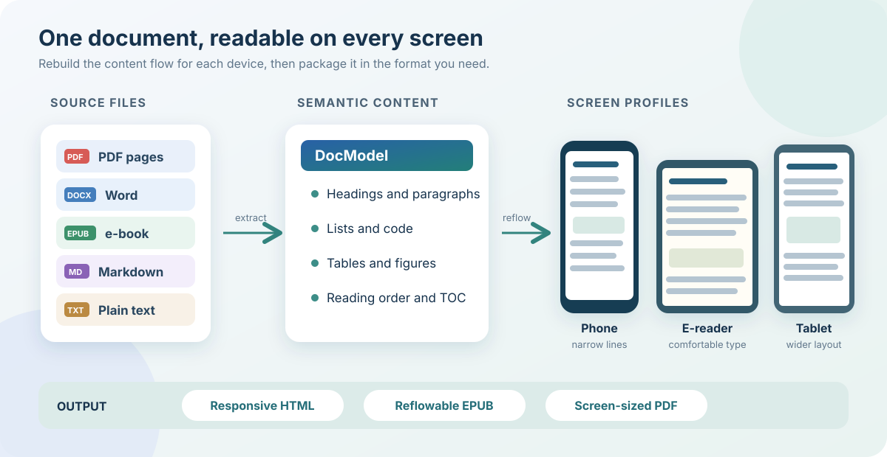

# doc2screen

Turn documents into **screen-adaptive reading editions**: one semantic source, multiple outputs — self-contained HTML, EPUB3, and device-sized PDF.

doc2screen does not wrap the original PDF layout in HTML. It extracts headings, paragraphs, lists, code, tables, and figures into a `DocModel`, then renders a reflowable single-column reader. That is what makes a document readable on a 6-inch phone instead of merely zoomable.

This repository is also a Claude Code and Codex skill: `SKILL.md` tells the agent how to drive the CLI.



## Why

Existing tools solve pieces:

- **MinerU / Docling / Marker** extract layout/OCR/tables, but stop at Markdown/JSON/HTML;
- **pdf2htmlEX** preserves layout but cannot reflow;
- **k2pdfopt** reflows PDFs for small screens, but outputs PDF, not semantic HTML;
- **PDF-Reflow** prototypes the end-to-end idea, but only for PDF and is very new.

doc2screen focuses on the missing last mile: **unified document model + screen profiles + content cleanup + image strategy + HTML/EPUB/PDF packaging + automatic verification**.

## Features (v0.1)

- Input: PDF (text layer), DOCX, ODT, EPUB, HTML, Markdown, RST, LaTeX, TXT.
- Output: self-contained HTML, EPUB3, PDF sized to a screen profile.
- Profiles: `phone-notes` (390×552, ratio 0.706, default), `phone-16x9.5` (390×657), `phone-16x9`, `phone-19.5x9`, `kindle`, `a5`, `a4`, custom.
- Reader: TOC drawer, progress bar, font size, dark/light theme, code copy, image viewer with fit/rotate/horizontal-strip modes.
- Figures: dedupe, aspect-based layout, caption association, print-safe scaling.
- Cleanup: remove repeated headers/footers/page numbers; trim by heading; drop text/assets explicitly; audit-friendly.
- Verification: HTML overflow at 15/21px, image loading, figure box height, TOC anchors; PDF page size/blank pages/image aspect/bookmarks; EPUB zip/OPF/nav.
- PDF bookmarks from headings (PyMuPDF, optional).

## Install

Requirements:

- Python 3.11+
- `pymupdf`, `lxml`
- `pandoc`
- Node.js + `puppeteer-core` (for PDF/HTML verification)
- Google Chrome or Chromium (PDF export)

Install as a skill for Claude Code or Codex, or clone anywhere to use the CLI directly:

```bash
# Claude Code (for Codex, use the commented path instead)
SKILL_DIR="$HOME/.claude/skills/doc2screen"
# SKILL_DIR="${CODEX_HOME:-$HOME/.codex}/skills/doc2screen"
git clone https://github.com/Gitputout/doc2screen.git "$SKILL_DIR"
cd "$SKILL_DIR"
python3 -m pip install pymupdf lxml
npm ci --prefix tools
python3 scripts/doc2screen.py doctor
```

For CLI-only use, clone into any directory and run the same dependency commands there.

On macOS/Linux, `pandoc` is available via Homebrew (`brew install pandoc`) or apt (`apt install pandoc`). Chrome must be installed for PDF export; set `CHROME_PATH` if it is not in a standard location.

`doctor` prints versions and resolved paths.

Default `build` output is **PDF only**. Add HTML/EPUB explicitly with `--formats pdf,html,epub`.

## Quick start

```bash
SKILL=/path/to/doc2screen

# Inspect
python3 "$SKILL/scripts/doc2screen.py" inspect input.pdf --out work/

# Build a phone-sized PDF (default), keeping only a section
python3 "$SKILL/scripts/doc2screen.py" build input.pdf \
  --profile phone-notes \
  --start-at "Linux 命令面试题" \
  --end-at "推荐学习" \
  --drop-text "扫码" --drop-text "公众号" \
  --drop-asset a0004 \
  --title "Linux 命令 + Git 面试题" \
  --out out/
```

Outputs (default):

```
out/
  <title>.pdf
  build.json
```

Add HTML/EPUB explicitly:

```
--formats pdf,html,epub
```

```
out/
  <title>.pdf
  <title>.html
  <title>.epub
  build.json
```

## CLI

```
doc2screen inspect <input> [--out work]
doc2screen extract <input> [--out work] [--fix old=new ...]
doc2screen render <doc.json> [--profile name] [--out file.html] [--no-embed]
doc2screen build <input> [--profile name] [--formats pdf]
                        [--start-at text] [--end-at text]
                        [--drop-text text ...] [--drop-asset id ...]
                        [--title title] [--name filename]
                        [--no-embed] [--no-bookmarks] [--no-verify]
doc2screen verify <file-or-dir> [--profile name]
doc2screen doctor
doc2screen profiles
```

- `--fix old=new`: repair known text-layer errors (repeatable). Example: `--fix 端又=端口`.
- `--start-at/--end-at`: trim everything before/after a heading.
- `--drop-text`: drop blocks containing text (repeatable). Review before use.
- `--drop-asset`: drop a figure by asset id (find it in `work/doc.json`).
- Trim requests fail if the start/end text is not found. `build.json` lists the removed block ids and reasons in `trim.removedBlocks`.
- `--no-embed`: write an assets folder instead of base64-inlining images.

## Profiles

`profiles/devices.json`:

| id | CSS size | Use |
|---|---|---|
| phone-notes | 390×552 | 0.706 (Huawei Notes-like), default |
| phone-16x9.5 | 390×657 | 6.39-inch 16:9.5 full-screen |
| phone-16x9 | 390×693 | 16:9 phone |
| phone-19.5x9 | 390×845 | tall phone |
| kindle | 600×800 | Kindle 6-inch |
| a5 | 559×794 | A5 |
| a4 | 794×1123 | A4 |

Custom: `--width 412 --height 733`.

**A device's aspect ratio and the reading page ratio are different.** A 6.39″ 16:9.5 screen is ~82.9 × 139.6 mm, but a 0.706 page at 390 CSS px is ~82.9 × 117.4 mm — shorter on purpose, so app toolbars and page margins do not eat the last lines. Full methodology and formulas: [`docs/screen-profiles.md`](docs/screen-profiles.md).

Compute a profile from a device:

```bash
python3 scripts/profile_helper.py \
  --inches 6.39 --aspect 16:9.5 \
  --page-ratio 0.706 --css-width 390 \
  --name phone-notes
```

It prints physical mm, CSS/PDF dimensions, suggested font/margin, and a JSON snippet.

## DocModel

`work/doc.json` is the single source for all outputs. See `DESIGN.md` for the schema. Key blocks:

`heading | paragraph | list | code | table | figure | quote | callout | divider`

Each block can carry `source.page/bbox`; assets are deduplicated by SHA-256.

## Image strategy

| aspect | HTML | EPUB/PDF |
|---|---|---|
| < 1.45 | fit width | fit width |
| 1.45–4.0 | rotate 90° / fit | fit / rotate |
| ≥ 4.0 | horizontal strip + lightbox | full width (panels planned) |
| scans | page image + lightbox | page image |

In print CSS, images are scaled with `max-height` so tall screenshots are not clipped.

## Verification

`verify` checks:

- HTML: document overflow at profile width and 15/21px; all images loaded; figure boxes non-zero; TOC anchors resolve; no JS errors.
- PDF: page size, blank pages, image aspect, outline.
- EPUB: `mimetype` first/uncompressed; XML valid; manifest hrefs exist; nav present.

A failed check returns a non-zero exit code.

When you verify a build directory, `verify` reads the profile from `build.json` unless `--profile` is given or both `--width` and `--height` are set.

CI runs the end-to-end smoke test with a document containing an image and hard line break, then checks the generated HTML, EPUB, and PDF.

## Support matrix

| Input | v0.1 |
|---|---|
| PDF text layer | ✅ (PyMuPDF) |
| PDF scanned | ⚠️ warning; plan MinerU/Tesseract adapter |
| DOCX/ODT | ✅ (Pandoc) |
| EPUB/HTML/Markdown/RST/LaTeX | ✅ (Pandoc) |
| TXT | ✅ |
| PPTX | ❌ v0.1 (use LibreOffice/pandoc later) |

## Known limitations

- Scanned PDFs need OCR; text is not fabricated.
- Complex multi-column papers/tables may need MinerU/Docling; warnings are reported.
- EPUB wide images are full-width (panel splitting is planned).
- PDF export requires Chrome; WeasyPrint fallback is planned.
- `pymupdf` is AGPL-3.0/commercial; for a permissive open-source core, switch to pypdfium2. See `THIRD_PARTY.md`.

## License and compliance

- **v0.1 is licensed under AGPL-3.0** (see `LICENSE`), because the PDF backend imports PyMuPDF, which is AGPL-3.0 or commercial.
- A future pypdfium2 backend can allow a permissive license; until then, do not describe this repository as Apache-2.0/MIT.
- PyMuPDF is **AGPL-3.0 or commercial**; local/personal use is fine. Do not distribute a bundled build without complying.
- Pandoc (GPL), Chrome (proprietary), MinerU (check `LICENSE.md`) are external commands, not vendored.
- Only convert documents you have the right to use; output inherits the source document's copyright.
- Research notes and clean-room provenance: `references/research.md`.
- Third-party notices: `THIRD_PARTY.md`.

## Development

```bash
python3 -m py_compile scripts/*.py
node -c scripts/export_pdf.js
node -c scripts/verify_html.js
python3 -m unittest discover -s tests
bash tests/smoke.sh
```
